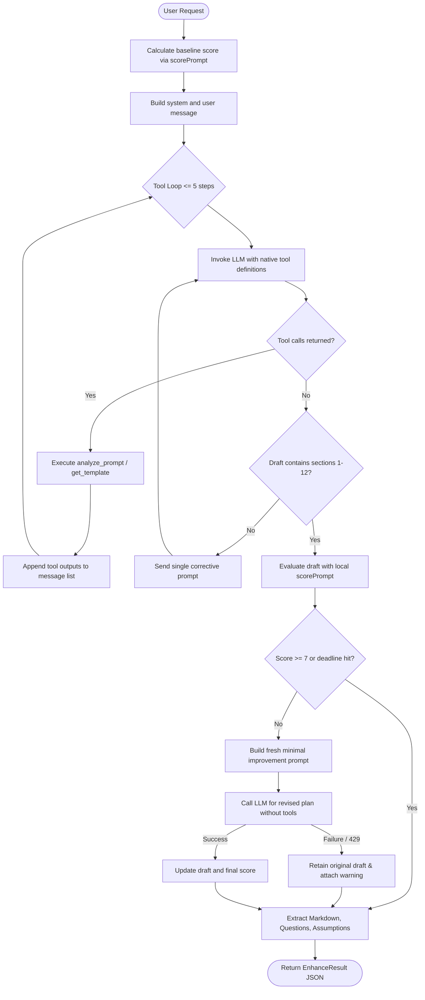
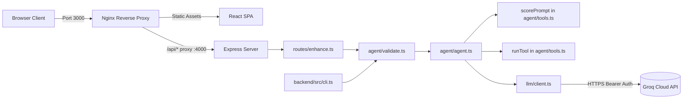

# Prompt Enhancer Agent

Prompt Enhancer Agent transforms rough, ambiguous website ideas (e.g. *"develop a cafe website"*) into structured, implementation-ready 12-section project specifications designed for downstream AI website builders.

It addresses common AI generation pitfalls—vague scopes, hallucinated business logic, unstated technical assumptions, and missing data models—by enforcing explicit section structures, requirement validation, and deterministic scoring.

---

## 1. Overview

Building websites with generative AI often fails when prompts are brief or underspecified, resulting in missing routes, missing database models, and invented business logic. 

Prompt Enhancer Agent accepts a user prompt (up to 2,000 characters) and executes an autonomous tool-calling agent loop. The agent classifies the project, extracts architectural patterns, produces a 12-section blueprint, and deterministically scores the result. If quality falls below 7/10, an improvement pass refines the plan while preserving user requirements.

---

## 2. Features

Verified directly in backend and frontend source code:

- **2,000-Character Prompt Limit**: Enforced during request validation (`backend/src/agent/validate.ts`).
- **Three Plan Styles**:
  - `short`: Terse bullets across all 12 sections (~2,000 max tokens).
  - `detailed`: Full implementation rationale and design decisions (~3,000 max tokens).
  - `technical`: API contracts, schemas, constraints, and validation rules (~3,500 max tokens).
- **Native Tool Calling**: Utilizes OpenAI-compatible function calling interfaces for `analyze_prompt` and `get_template`.
- **Deterministic Quality Scoring (`scorePrompt`)**: Local scoring engine (0–10) checking section coverage, `[Confirmed]` / `[Assumed]` tagging, MVP scope separation, task dependencies, and test validation criteria.
- **Automated Improvement Pass**: Runs when `score < 7` using a fresh, compact conversation context without prior tool history to correct defects.
- **Before & After Scoring**: Displays quality delta from raw prompt to enhanced plan.
- **Explicit Ambiguity Segregation**: Parses blocking questions (`=====QUESTIONS=====`) and non-blocking assumptions (`=====ASSUMPTIONS=====`) into structured arrays.
- **Change Request Mode ("Use as previous plan")**: UI button populates `previousPlan` (up to 20,000 characters). The agent modifies only affected areas and appends `## Change log`.
- **Agent Steps Inspector**: Collapsible UI disclosure displaying each tool execution, input arguments, and compact output.
- **Clipboard Export**: One-click markdown copy button with transient feedback state.
- **Dual Interfaces**: Web interface (React + Vite) and standalone CLI (`backend/src/cli.ts`).
- **Production Containerization**: Pre-configured Docker Compose multi-container setup with healthchecks and reverse proxying.

---

## 3. Agent Workflow

The orchestration sequence implemented in `backend/src/agent/agent.ts`:



### 429 Rate-Limit and Failure Handling
- **Rate Limit Parsing**: Reads the `Retry-After` HTTP header or parses error messages (`try again in Xs`).
- **Bounded Retry**: If the indicated wait time is $\le 35$ seconds, waits once and retries once. If the wait is $> 35$ seconds, throws `LLMError(429)` immediately. Infinite retries are prohibited.
- **Improvement Fallback**: If the optional improvement pass fails (due to 429, timeout, or invalid output), the original complete draft is preserved, returning `warning: "improvement pass failed: <reason>"`.
- **Credential & Body Protection**: API keys and full upstream response bodies are never logged.

---

## 4. The 12 Sections

All generated plans must contain the following 12 numbered sections in order (`backend/src/agent/prompt.ts`):

1. `## 1. Intent`: Product classification, purpose, business, functional, and technical intent.
2. `## 2. Requirements`: Functional and non-functional requirements. Every requirement must be explicitly tagged as `[Confirmed]` or `[Assumed]`.
3. `## 3. Ambiguities and questions`: Blocking questions that alter build requirements. Minor items become assumptions.
4. `## 4. Scope`: Must contain three distinct sublists labeled:
   - `MVP`
   - `Optional features`
   - `Future enhancements`
5. `## 5. Users and journeys`: User roles, permissions, and primary workflows.
6. `## 6. Architecture`: Frontend, backend, database, and integration topology.
7. `## 7. Technology`: Recommended technologies with concise justifications.
8. `## 8. Database plan`: Entities, relationships, constraints, and data attributes.
9. `## 9. UI/UX plan`: Pages, components, responsive behavior, empty states, and error handling.
10. `## 10. Task breakdown`: Sequential tasks (`T1`, `T2`, etc.) with explicit `Expected output` and `Depends on: T# / none`.
11. `## 11. Risks`: Security considerations, technical risks, and edge cases.
12. `## 12. Validation`: Testable acceptance criteria and concrete testing requirements.

Plans conclude with exact parsing delimiters:
```markdown
=====QUESTIONS=====
- <blocking question or none>

=====ASSUMPTIONS=====
- <labelled assumption or none>
```

---

## 5. Tech Stack & Architecture

- **Frontend**: React 18, TypeScript, Vite 5, `react-markdown`, `remark-gfm`.
- **Web Proxy**: Nginx Alpine reverse proxying `/api/` to backend and serving the SPA.
- **Backend**: Node.js (20+), Express 4, TypeScript, `helmet`, `cors`, `express-rate-limit`, `tsx`.
- **AI Integration**: Groq Cloud API (`openai/gpt-oss-120b` or `llama-3.3-70b-versatile`) via native tool calling.



---

## 6. Project Structure

```
prompt-enhancer/
├── .env.example
├── .gitignore
├── docker-compose.yml
├── README.md
├── backend/
│   ├── .dockerignore
│   ├── Dockerfile
│   ├── package.json
│   ├── tsconfig.json
│   └── src/
│       ├── cli.ts
│       ├── server.ts
│       ├── agent.test.ts
│       ├── agent/
│       │   ├── agent.ts
│       │   ├── prompt.ts
│       │   ├── tools.ts
│       │   └── validate.ts
│       ├── llm/
│       │   └── client.ts
│       └── routes/
│           └── enhance.ts
└── frontend/
    ├── .dockerignore
    ├── Dockerfile
    ├── index.html
    ├── nginx.conf
    ├── package.json
    ├── tsconfig.json
    ├── vite.config.ts
    └── src/
        ├── App.tsx
        ├── api.ts
        ├── main.tsx
        ├── styles.css
        └── vite-env.d.ts
```

---

## 7. Prerequisites & Environment Setup

### Prerequisites
- Node.js >= 20.17.0
- npm >= 10.0.0
- Docker and Docker Compose (for containerized execution)

### Environment Configuration
Copy `.env.example` to `.env` in the project root:

```bash
cp .env.example .env
```

Set configuration variables using your provider credentials:

```ini
# Upstream LLM Configuration
LLM_API_KEY=your_api_key_here
LLM_BASE_URL=https://api.groq.com/openai/v1
LLM_MODEL=openai/gpt-oss-120b
LLM_TIMEOUT_MS=60000

# Optional Style Max Token Overrides
LLM_MAX_TOKENS_SHORT=2000
LLM_MAX_TOKENS_DETAILED=3000
LLM_MAX_TOKENS_TECHNICAL=3500

# Server Configuration
PORT=4000
CORS_ORIGIN=http://localhost:3000,http://localhost:5173
```

> [!WARNING]
> Never commit the `.env` file or hardcode credentials into the repository. The `.gitignore` file excludes `.env`.

---

## 8. Local Development & CLI

### Local Backend
Run in PowerShell or Bash:

```powershell
cd backend
npm install
npm run dev
```
Backend runs on `http://localhost:4000`.

### Local Frontend
```powershell
cd frontend
npm install
npm run dev
```
Vite development server runs on `http://localhost:5173`.

### CLI Execution
Run the agent directly from the command line:

```powershell
# Default style (detailed)
npm run cli -- "develop a cafe website"

# Short style
npm run cli -- "develop a portfolio website" --style short

# Technical style with step logs
npm run cli -- "develop a railway booking portal" --style technical --verbose
```

### Docker CLI Execution
```bash
docker compose run --rm backend node dist/cli.js "develop a cafe website"
```
*(Note: Docker CLI invocation requires pre-built images via `docker compose build` and is marked as untested in local verification).*

---

## 9. API Reference

### Health Check
`GET /api/health`

**Response (`200 OK`):**
```json
{
  "status": "ok"
}
```

### Enhance Prompt
`POST /api/enhance`

**Request Body (`application/json`):**
| Field | Type | Required | Description |
|---|---|---|---|
| `prompt` | `string` | Yes | Website idea or change request (1–2,000 characters). |
| `style` | `string` | No | `"short"` \| `"detailed"` \| `"technical"` (defaults to `"detailed"`). |
| `previousPlan` | `string` \| `null` | No | Existing Markdown plan for change requests ($\le 20,000$ characters). |

**Response Body (`200 OK`):**
```json
{
  "original": "develop a cafe website",
  "enhanced": "## 1. Intent\n...",
  "questions": ["Do you require table booking integration?"],
  "assumptions": ["Assumed standard operating hours 8am-8pm."],
  "score": {
    "before": 2,
    "after": 9
  },
  "steps": [
    {
      "step": 1,
      "tool": "analyze_prompt",
      "input": { "prompt": "develop a cafe website" },
      "output": { "project_type": "cafe_restaurant", "mode": "new_build", "missing": ["constraints"] }
    }
  ],
  "warning": null
}
```

### HTTP Status Codes
- `200`: Success.
- `400`: `InputError` (empty/oversized prompt, invalid style, oversized `previousPlan`, invalid JSON body).
- `429`: Rate limit exceeded (Express route rate limit of 20 req/min per IP, or upstream provider TPM limit).
- `500`: `LLMError(500)` (missing or invalid `LLM_API_KEY`) or unhandled internal error.
- `502`: `LLMError(502)` (upstream AI provider failure, unreadable response, or missing plan).
- `504`: `LLMError(504)` (provider timeout $> 60$s or overall agent timeout $> 150$s).

---

## 10. Testing

Tests are located in `backend/src/agent.test.ts` using the native Node.js test runner (`node:test`) and strict assertions (`node:assert/strict`). All network requests are mocked via `globalThis.fetch` without live API calls or Docker dependencies.

### Running Tests
```powershell
cd backend
npm test
npm run build
```

### Verified Test Run Output
```text
> prompt-enhancer-backend@1.0.0 test
> tsx --test src/agent.test.ts

[LLM provider error] { status: 429, retryAfter: '0', remainingTokens: null }
[LLM response] {
  finishReason: undefined,
  hasToolCalls: false,
  contentLength: 16,
  promptTokens: 15,
  completionTokens: 25,
  totalTokens: 40
}
[LLM provider error] { status: 429, retryAfter: '45', remainingTokens: null }
[LLM response] {
  finishReason: undefined,
  hasToolCalls: false,
  contentLength: 383,
  promptTokens: 100,
  completionTokens: 150,
  totalTokens: undefined
}
[LLM provider error] { status: 429, retryAfter: '60', remainingTokens: null }
[agent] improvement pass failed: Rate limit reached, retry in ~60s.
✔ 429 with Retry-After waits and retries successfully (15.5415ms)
✔ 429 with wait > 35s throws LLMError without infinite retries (1.1188ms)
✔ missing API key throws LLMError(500) (0.2717ms)
✔ invalid input validation throws InputError for empty, too long, and bad style (0.3878ms)
✔ improvement failure keeps first plan and records warning (2.5166ms)
✔ all 12 headings parsed and detected by scorePrompt (0.8552ms)
ℹ tests 6
ℹ suites 0
ℹ pass 6
ℹ fail 0
ℹ cancelled 0
ℹ skipped 0
ℹ todo 0
ℹ duration_ms 678.3417

> prompt-enhancer-backend@1.0.0 build
> tsc
```

---

## 11. Docker Deployment

### Services Overview
- `backend`: Built from `./backend/Dockerfile`, tagged `promptenhancer-backend:1.0`, bound to port `4000:4000`. Includes healthcheck probing `/api/health`.
- `frontend`: Built from `./frontend/Dockerfile`, tagged `prompt-enhancer-frontend:1.0`, bound to port `3000:80`. Depends on healthy backend service.

### Common Commands
```bash
# Build and start services in background
docker compose up --build -d

# Check service status and healthcheck
docker compose ps

# View real-time logs
docker compose logs -f

# Stop and remove containers
docker compose down
```

---

## 12. Error Handling & Limitations

- **Provider Token Limits**: Groq free tier enforces strict TPM (Tokens Per Minute) ceilings (e.g. 8,000 TPM including input and requested `max_tokens`). High token requests or bursts will trigger 429 responses.
- **Single Improvement Pass**: The agent attempts at most one improvement iteration when `score < 7` to avoid depleting provider token budgets.
- **Tool Recursion Limit**: Native tool execution is bounded by `MAX_STEPS = 5`.
- **No Direct Database State**: The app is stateless; plans and step histories exist only in browser memory and terminal stdout unless persisted by the client.

---

## 13. Deployment (Production)

- **Frontend (Vercel / Netlify)**: [TODO / Not Deployed]
  - Root directory: `frontend`
  - Build command: `npm run build`
  - Output directory: `dist`
  - Environment variable: `VITE_API_URL=https://<your-render-backend-url>`
- **Backend (Render)**: [TODO / Not Deployed]
  - Root directory: `backend`
  - Build command: `npm install && npm run build`
  - Start command: `npm start`
  - Environment variables: Configure `LLM_API_KEY`, `CORS_ORIGIN=https://<your-frontend-url>`, `PORT=4000`.

---

## 14. Example Prompts & Screenshots

### Example Prompts and Results
- [TODO: Run `develop a cafe website` and record summary result]
- [TODO: Run `develop a website for railway ticket booking` and record summary result]
- [TODO: Run `add online food ordering` using previous plan and record change log result]

### Screenshots
- [TODO: Attach screenshot of main input interface]
- [TODO: Attach screenshot of 12-section enhanced output with before/after score]
- [TODO: Attach screenshot of expanded agent steps inspection drawer]
